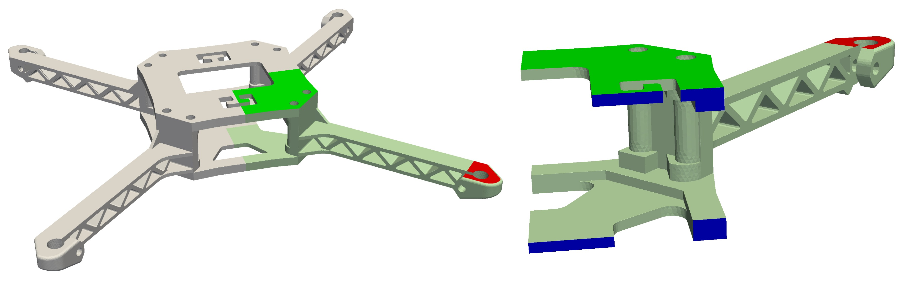
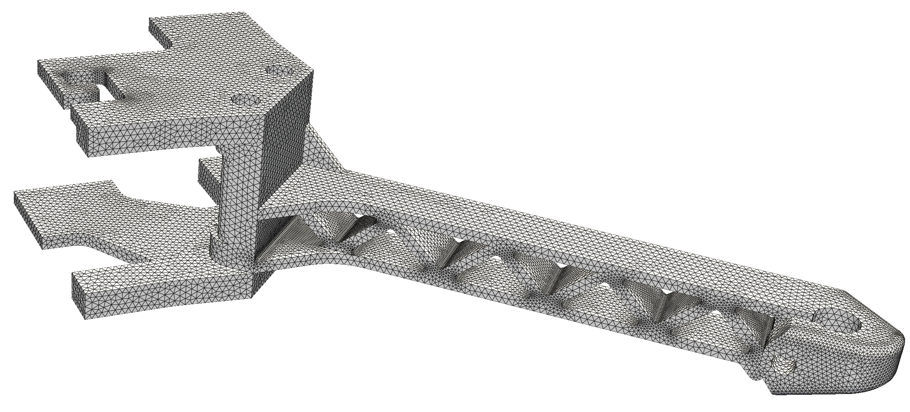
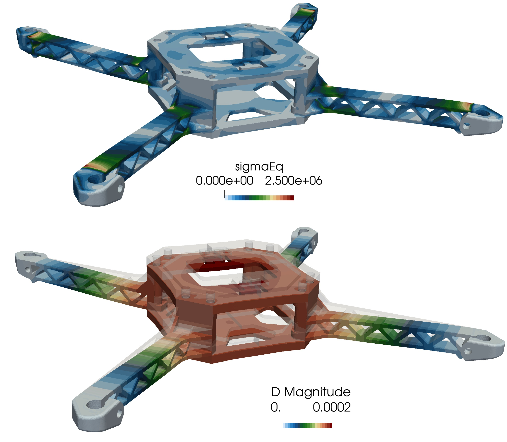

# Custom workflow tutorial: `droneFrame`

Prepared by: Ivan Batistić and Philip Cardiff

---

## Tutorial Aims

- Show the complete workflow for a custom `solids4foam` case: prepare the
  geometry, generate a tetrahedral mesh with `Gmsh`, convert the mesh to
  `OpenFOAM` format, set up the case files, run the solver, and post-process
  the results.

- Show how to use symmetry planes to reduce the computational domain to one
  quarter of the drone frame.

- Show how to run the case with the coupled `PETScSNES` solution algorithm and
  the high-order discretisation.

## Prerequisites

Prerequisites for this tutorial are:

- `solids4foam-v2.4` compiled with `PETSc` support
- `openfoam2412`
- `Gmsh-4.14`
- `ParaView-5.13.2`

It is possible to follow the tutorial steps with other `OpenFOAM`, `Gmsh` and
`ParaView` versions, but be aware of possible minor differences. The high-order
discretisation and the `PETScSNES` solution algorithm are not available in
solids4foam versions before v2.4.

## Problem description

This tutorial analyses the frame of a small quadcopter drone. The frame is a
3D-printed design that consists of two centre plates and four arms. Each arm
holds one motor on a pad at its end. The design is a slightly simplified
version of a [GrabCAD model](https://grabcad.com/library/3d-printed-mini-quadcopter-1),
and a similar frame was analysed by
[Martinetti et al. (2018)](https://www.sciencedirect.com/science/article/pii/S2351978918312812)
in a study of landing loads on micro drones.

The frame has two planes of symmetry that pass through the centre of the
plates. We use these planes to reduce the computational domain to one quarter
of the frame: one arm and the corner of the two plates, as shown in the image
below. The load case is a hard landing. On landing, the frame decelerates, and
we assume that the motors support the frame during the deceleration. We model
this as a static problem with
a load factor of 10, which means that all masses are loaded with 10 times the
gravitational acceleration. For this analysis, we make the following assumptions:

- The motor seat on top of the motor pad (red surface) is fixed.
- Symmetry conditions are applied on the two cut planes (blue surfaces).
- We assume that the battery and electronics have a total mass of 150 g and rest
  on the top plate. With a load factor of 10, this gives a force of 14.7 N on
  the complete top plate, which has an area of 3424 mm². We apply this force as
  a uniform pressure of 4.3 kPa on the top plate (green surface).
- The frame is loaded with its own weight. The gravitational acceleration acts
  in the negative `y` direction and is multiplied by the load factor of 10.
- The frame is made of ABS plus plastic with a Young's modulus of 2.5 GPa, a
  Poisson's ratio of 0.35 and a density of 1040 kg/m³.
- The analysis assumes small deformations and a linear elastic (Hookean)
  material response.
- All parts of the frame are modelled as one body (linear analysis). The
  bolts between the arms and the plates are not modelled.



### Loading (green), fixed (red) and symmetry (blue) surfaces

## Step 1. Preparing case geometry

For convenience, we will set up the `SOLIDS4FOAM_DIR`
variable to point to the `solids4foam` installation directory. Since this
location is user-dependent, this will ensure that the subsequent commands are
applicable to all users:

```bash
export SOLIDS4FOAM_DIR=<PATH_TO_SOLIDS4FOAM>
```

where you should replace `<PATH_TO_SOLIDS4FOAM>` with the location
of the solids4foam directory on your system. Optionally, make it permanent
by adding it to `~/.bashrc`:

```bash
echo 'export SOLIDS4FOAM_DIR=<PATH_TO_SOLIDS4FOAM>' >> ~/.bashrc
source ~/.bashrc
```

Now, create a new directory for this case and navigate into it:

```bash
mkdir droneFrame
cd droneFrame
```

Download and unpack the geometry:

```bash
wget https://www.solids4foam.com/tutorials/archive/droneFrame.zip \
  && unzip droneFrame.zip && rm -rf droneFrame.zip
```

The geometry is provided as one STEP file, `droneFrame.stp`.
Unlike an STL file, it describes the exact surfaces of the part, not a triangulation.
The mesher reads the surfaces directly, and each CAD face keeps its own identity.
We will use this identity in the next step to assign the boundary patches.

The geometry was prepared in Rhino from the full frame assembly, but other
CAD software such as FreeCAD or Salome can also be used. The preparation
consisted of three steps:

- The motors, propellers, battery, electronics and screws were removed. Only
  the two plates and the four arms remained.
- The plates and the arms were joined into one solid body. The bolted
  connections are not modelled, so the parts are bonded.
- The body was cut along the two symmetry planes, and one quarter was kept.
  The top face of the motor pad was split from the top face of the arm, so
  that the motor seat is a separate CAD face.

Before meshing, it is good practice to inspect the geometry. ParaView cannot
open STEP files, so we use the Gmsh graphical interface instead:

```bash
gmsh droneFrame.stp
```

```tip
Gmsh reads `STEP` files through the OpenCASCADE geometry kernel. Make sure
your Gmsh installation includes OpenCASCADE support. The official binaries
from gmsh.info do. You can check this with `gmsh -info`, which lists
`OpenCASCADE` under *Build options*.
```

```tip
Before meshing, always inspect your CAD files for flaws like gaps,
overlapping faces, non-manifold edges, or incorrect units. Fix
these in the CAD software. The mesher cannot fix them, and it will produce a
bad mesh or fail.
```

## Step 2. Meshing using gmsh

Before meshing, we must populate the case directory with the necessary
 `OpenFOAM` files. The most efficient way to do this is to copy the structure
 from a similar tutorial case. Since our simulation assumes small deformations
 and a linear elastic material, the cases in
 `solids4foam/tutorials/solids/linearElasticity` are a good starting point.
 We will use the `plateHole` tutorial:

```bash
PLATE_HOLE=$SOLIDS4FOAM_DIR/tutorials/solids/linearElasticity/plateHole
cp -r $PLATE_HOLE/{0,constant,system} .
rm -f system/blockMeshDict system/*.* constant/*.* constant/timeVsTraction
```

The `plateHole` case contains several variants of the `solidProperties`,
`fvSchemes` and `fvSolution` dictionaries, with suffixes.
The second command removes these variants and the `blockMeshDict` file, which
are not needed here.

Gmsh is an open-source mesh generator. It can read STEP geometry directly
and generate tetrahedral meshes. We control it with a script file, which we
will call `droneFrame.geo`. Create this file in the case directory:

```bash
touch droneFrame.geo
```

and add following content:

```geo
SetFactory("OpenCASCADE");
Merge "droneFrame.stp";          // geometry in millimetres

Mesh.CharacteristicLengthMin = 0.4;
Mesh.CharacteristicLengthMax = 1.0;
Mesh.CharacteristicLengthFromCurvature = 1;
Mesh.MinimumElementsPerTwoPi = 12;
Mesh.Algorithm   = 6;             // Frontal-Delaunay (2D)
Mesh.Algorithm3D = 10;            // HXT (3D)
Mesh.Optimize    = 1;
Mesh.OptimizeNetgen = 1;

// --- output ---
Mesh.ScalingFactor  = 0.001;      // mm -> m
Mesh.MshFileVersion = 2.2;        // format read by gmshToFoam

// --- boundary patches (CAD face tags from the STEP file) ---
symX()        = {9, 10, 43, 44};  // cut plane x = 0
symZ()        = {7, 8, 42};       // cut plane z = 0
plateTop()    = {35};             // top face of upper plate (y = 28.1)
plateBottom() = {179};            // bottom face of lower plate (y = 0)
motorPad()    = {203};            // top face of the motor pad (motor seat)
free() = Surface{:};
free() -= symX(); free() -= symZ(); free() -= plateTop();
free() -= plateBottom(); free() -= motorPad();

Physical Surface("symX")        = symX();
Physical Surface("symZ")        = symZ();
Physical Surface("plateTop")    = plateTop();
Physical Surface("plateBottom") = plateBottom();
Physical Surface("motorPad")    = motorPad();
Physical Surface("free")        = free();
Physical Volume("frame")        = Volume{:};
```

The script has four parts:

- **Geometry**. The SetFactory line selects the OpenCASCADE kernel, which is
  necessary to read STEP files. The Merge command loads the geometry.
- **Mesh size**. The cell size is between 0.4 mm and 1.0 mm. The arm has thin
  truss members of about 1.7 mm, so the upper limit of 1.0 mm gives at least
  two cells across each member. The `CharacteristicLengthFromCurvature` option
  refines the mesh on curved surfaces, such as the holes, so that each full
  circle has at least 12 cells. `Algorithm3D = 10` selects the HXT algorithm,
  which is fast and robust for large tetrahedral meshes.
- **Output**. The geometry is in millimetres, so `Mesh.ScalingFactor` scales
  the mesh to metres when it is written. The g`mshToFoam` utility reads the
  msh format version 2, so we set `Mesh.MshFileVersion`to 2.2.
- **Boundary patches**. Each boundary patch is a Physical Surface, a named
  group of CAD faces. The faces are identified by their tag in the STEP file.
  The last group, free, contains all faces that are not in another group. A
  Physical Volume is also necessary; without it, Gmsh does not write the
  cells.

```tip
To find the tag of a CAD face, open the geometry in the Gmsh graphical
interface with `gmsh droneFrame.stp`. Select *Tools > Options > Geometry* and
tick *Surface labels* under *Visibility*. The tag of each face is then shown
in the graphics window. Alternatively, hover the mouse over a face and its tag
is shown in the status bar.
```

Now, run the mesher:

```bash
gmsh -3 droneFrame.geo -o droneFrame.msh
```

The `-3` flag tells Gmsh to generate a 3D mesh. The mesh generation takes a
 few seconds, and the end of the output reports the mesh size:

```bash
Info    : Done meshing 2D (Wall 0.798737s, CPU 0.792499s)
Info    : Done meshing 3D (Wall 0.431752s, CPU 0.404607s)
Info    : 36428 nodes 198736 elements
```

The mesh is in the Gmsh msh format. We convert it to OpenFOAM format with
 the gmshToFoam utility:

```bash
gmshToFoam droneFrame.msh
```

The utility writes the mesh in the `constant/polyMesh` directory. Now we can
inspect the mesh in ParaView. The `touch` command creates a dummy file that
allows ParaView to recognise the folder as an `OpenFOAM` case:

```bash
touch case.foam && paraview case.foam
```



### Computational mesh

After generating the mesh, one should always inspect the
`constant/polyMesh/boundary` file. The `gmshToFoam` utility assigns the
generic `patch` type to all patches. This is correct for the traction and
displacement boundaries, but the two symmetry planes must have the `symmetry`
type. We can change the type by editing the file, or with the
`foamDictionary` utility, which is available in `OpenFOAM.com` and
`OpenFOAM.org`, but not in `foam-extend`:

```bash
foamDictionary constant/polyMesh/boundary -entry entry0/symZ/type -set symmetry
foamDictionary constant/polyMesh/boundary -entry entry0/symX/type -set symmetry
```

The boundary file should now look like this:

```bash
6
(
    free
    {
        type            patch;
        physicalType    patch;
        nFaces          45539;
        startFace       256551;
    }
    symZ
    {
        type            symmetry;
        physicalType    patch;
        nFaces          254;
        startFace       302090;
    }
    symX
    {
        type            symmetry;
        physicalType    patch;
        nFaces          290;
        startFace       302344;
    }
    plateTop
    {
        type            patch;
        physicalType    patch;
        nFaces          2824;
        startFace       302634;
    }
    plateBottom
    {
        type            patch;
        physicalType    patch;
        nFaces          2596;
        startFace       305458;
    }
    motorPad
    {
        type            patch;
        physicalType    patch;
        nFaces          579;
        startFace       308054;
    }
)
```

Finally, we perform a formal quality check with the checkMesh utility:

```bash
checkMesh
```

From the output of `checkMesh`, we can see that the mesh passed the test and
 is OK for use:

```plaintext
...
Mesh OK.
```

## Step 3. Preparing Case Files

With the mesh complete, we now need to configure the case files for
 the simulation.

### Boundary and Initial Conditions

First, open the `0/D` file to set the boundary and initial conditions for
 the displacement field `D`. We'll start with an initial condition of zero
 displacement for the entire domain:

```c++
internalField   uniform (0 0 0);
```

Next, we define the conditions for each boundary patch inside the
 `boundaryField` dictionary. The setup is as follows:

- `symX` and `symZ`: These patches are the two cut planes. The
  symmetry condition sets the normal displacement and the shear traction to
  zero.
- `motorPad`: This patch is the motor seat on top of the pad. Zero
  displacement is prescribed on this patch.
- `plateTop`: The weight of the battery and the electronics acts on this
  patch. A pressure of 4.3 kPa is applied, which includes the load factor of 10.
- `plateBottom` and `free`: These are free surfaces with no applied forces.

The final `0/D` file should look like this:

```c++
boundaryField
{
    symX
    {
        type            solidSymmetry;
        patchType       symmetry;
        value           uniform (0 0 0);
    }
    symZ
    {
        type            solidSymmetry;
        patchType       symmetry;
        value           uniform (0 0 0);
    }
    motorPad
    {
        type            fixedDisplacement;
        value           uniform (0 0 0);
    }
    plateTop
    {
        type            solidTraction;
        traction        uniform (0 0 0);
        pressure        uniform 4300;
        value           uniform (0 0 0);
    }
    plateBottom
    {
        type            solidTraction;
        traction        uniform (0 0 0);
        pressure        uniform 0;
        value           uniform (0 0 0);
    }
    free
    {
        type            solidTraction;
        traction        uniform (0 0 0);
        pressure        uniform 0;
        value           uniform (0 0 0);
    }
}
```

### Material and Solid Properties

Next, we need to adjust input dicts in the `constant` directory. Material
 properties are defined in `constant/mechanicalProperties`. We will specify
 the properties for ABS plus plastic:

```plaintext
planeStress     no;

mechanical
(
    ABSplus
    {
        type            linearElastic;
        rho             rho [1 -3 0 0 0 0 0] 1040;
        E               E [1 -1 -2 0 0 0 0] 2.5e9;
        nu              nu [0 0 0 0 0 0 0] 0.35;
    }
);
```

In the `constant/solidProperties` file, we select the solid mechanics model
and the solution algorithm. We will use the `linearGeometryTotalDisplacement`
model, which assumes small strains and rotations. Instead of the default
segregated algorithm, we select the coupled `PETScSNES` algorithm. In addition,
we switch on the high-order discretisation, which reconstructs the displacement
field with quadratic polynomials instead of linear ones.

```plaintext
// linearGeometry: assumes small strains and rotations
solidModel     linearGeometryTotalDisplacement;

"linearGeometryTotalDisplacementCoeffs"
{
    // Solution algorithm: segregated (default) or PETScSNES (Newton)
    solutionAlgorithm    PETScSNES;

    // High-order (quadratic) reconstruction of the displacement field
    highOrderCoeffs
    {
        highOrderJacobian false;
        highOrderResidual true;

        displacement
        {
            polynomialOrder 2;

            faceStencilExtraCells 55;

            weightFunctionCoeffs
            {
                type radiallySymmetricExponential;
                k 6;
            }
            calcConditionNumber false;
        }
    }

    stabilisation
    {
        momentum
        {
            type        alpha;
            scaleFactor 0.1;
        }
    }
}
```

The `highOrderCoeffs` dictionary controls the high-order discretisation:

- `highOrderResidual true` evaluates the momentum residual with the quadratic
  reconstruction. `highOrderJacobian false` keeps the standard second-order
  Jacobian as the preconditioner, which is cheaper to assemble.
- `polynomialOrder 2` selects quadratic polynomials.
- `faceStencilExtraCells 55` sets the extra number of neighbour cells added to the
  stencil of each face for the reconstruction.
- `weightFunctionCoeffs` sets the weights of the cells in the stencil. Cells
  further from the integration point get smaller weights.

The `stabilisation` dictionary adds a small amount of numerical diffusion to
 the momentum equation, which helps improve conditioning of the system.

```note
Use only the `alpha` stabilisation with the high-order discretisation. The
other stabilisation types are designed for the standard second-order
discretisation and are not compatible with the high-order residual.
```

```tip
The `PETScSNES` algorithm and the high-order discretisation require a
`solids4foam` build with `PETSc` support. If your build does not have it, set
`solutionAlgorithm` to `implicitSegregated` and remove the `highOrderCoeffs`
dictionary to use the segregated algorithm.
```

The gravitational acceleration is set in the `constant/g` file. We apply the
 load factor of 10 to the gravitational acceleration, so that the frame is
 loaded with ten times its own weight. This represents the deceleration of
 the frame on landing:

```bash
dimensions      [0 1 -2 0 0 0 0];
value           (0 -98.1 0);
```

The other files in the constant directory (`physicsProperties`,
 `dynamicMeshDict`) can remain unchanged.

### Numerical Schemes and Run-Time Control

In `system/fvSchemes`, the high-order discretisation requires the
`leastSquaresS4f` scheme for the gradient of the displacement, and the
`Gauss linear` for the divergence terms:

```c++
gradSchemes
{
    default                 leastSquaresS4f;
}

divSchemes
{
    default                 Gauss linear;
}
```

The other entries in `system/fvSchemes` remain unchanged.

In `system/fvSolution`, the `D` solver must be petsc when the PETScSNES
 algorithm is used. The options dictionary passes the settings to PETSc:

```bash
solvers
{
    D
    {
        solver          petsc;

        options
        {
            snes_type newtonls;
            snes_monitor;
            snes_converged_reason;
            snes_mf;
            snes_mf_operator;

            ksp_type lgmres;
            ksp_gmres_restart "100";
            ksp_converged_reason;

            pc_type bjacobi;
            sub_pc_type lu;
            snes_lag_preconditioner_persists true;
            snes_lag_preconditioner "-2";
        }
    }
}
```

The main entries are:

- `snes_type newtonls`: Newton method with a line search.
- `snes_mf and snes_mf_operator`: the Jacobian-vector products are
  calculated matrix-free from the residual, and the assembled second-order
  matrix is used only as the preconditioner.
- `ksp_type lgmres` and `pc_type bjacobi`: the linear system in each Newton
  iteration is solved with the LGMRES method and a block Jacobi
  preconditioner with an LU factorisation in each block.
- `snes_lag_preconditioner "-2"`: the preconditioner is assembled once and
  reused in all Newton iterations.
- `snes_monitor` and `*_converged_reason`: print the residuals and the
  convergence status to the log file.

In `system/controlDict`, we remove the libs entry and the `forceDisp1` and
`plateHoleAnalyticalSolution1` functions, which were copied from the tutorial case.
We keep the pointDisp function to monitor the displacement at a point, and set
the point to the corner of the bottom plate at the centre of the frame:

```bash
functions
{
    pointDisp
    {
        type          solidPointDisplacement;
        point         (0 0 0);
    }
}
```

The `endTime` and `deltaT` entries remain `1`, as we solve a static problem with
 one load increment.

## Step 4. Running the Case

To run the case, we will modify existing `Allrun` script. The script should look
 like this:

```bash
#!/bin/bash

# Source tutorial run functions
. $WM_PROJECT_DIR/bin/tools/RunFunctions

# Source solids4Foam scripts
source solids4FoamScripts.sh

# Check case version is correct
solids4Foam::convertCaseFormat .

# Generate the tetrahedral mesh with Gmsh (geometry in mm, mesh written in m)
runApplication gmsh -3 droneFrame.geo -o droneFrame.msh

# Convert the Gmsh mesh to OpenFOAM format
solids4Foam::runApplication gmshToFoam droneFrame.msh

# Set the patch type of the symmetry planes (gmshToFoam makes all patches 'patch')
solids4Foam::requireGnuSed
"${SOLIDS4FOAM_SED}" -i \
    -e '/symX/,/}/ s/type            patch;/type            symmetry;/' \
    -e '/symZ/,/}/ s/type            patch;/type            symmetry;/' \
    constant/polyMesh/boundary

# Check the mesh quality
solids4Foam::runApplication checkMesh

# Create an empty file so ParaView recognises the case
touch case.foam

# Run the solver
solids4Foam::runApplication solids4Foam
```

The `sed` command replaces the `foamDictionary` commands from Step 2 and works
with all `OpenFOAM` versions. It changes the `type` entry to `symmetry` inside
the `symX` and `symZ` dictionaries of the `boundary` file. The
`solids4Foam::requireGnuSed` function finds the GNU version of `sed` and stores
its name in the `SOLIDS4FOAM_SED` variable. This is necessary on macOS, where
the default `sed` uses a different syntax for in-place editing.

Make the script executable with the following command:

```bash
chmod +x Allrun
```

Now, you can run the entire simulation by simply executing the script:

```bash
./Allrun
```

To monitor residuals, we can open a new terminal and type the following
 command for live monitoring of the solver log file:

```bash
tail -f log.solids4Foam
```

```plaintext
Time = 1

Solving the momentum equation for D using PETSc SNES
Selecting least-squares reconstruction scheme movingLeastSquares
  0 SNES Function norm 7.314378885868e-02
    Linear solve converged due to CONVERGED_RTOL iterations 182
  1 SNES Function norm 1.388202771282e-02
    Linear solve converged due to CONVERGED_RTOL iterations 385
  2 SNES Function norm 1.261537438164e-07
    Linear solve converged due to CONVERGED_RTOL iterations 386
  3 SNES Function norm 4.247405433852e-11
  Nonlinear solve converged due to CONVERGED_FNORM_RELATIVE iterations 3
Max epsilonEq = 0.0010944
Max sigmaEq (von Mises stress) = 3.04001e+06
ExecutionTime = 312.59 s  ClockTime = 317 s

The momentum equation converged in all time-steps

End
...
```

The solver log file shows two levels of iterations:

- `SNES Function norm`: This is the residual of the momentum equation at
  each Newton iteration. The problem is linear, so the Newton method converges
  in a few iterations. Here the residual decreases by nine orders of magnitude
  in three iterations.
- `Linear solve converged`: This line reports the number of LGMRES iterations
  that the linear solver needed inside each Newton iteration. The linear
  system is solved to a relative tolerance of 1e-5.

The run takes about five minutes on one core.

The `pointDisp` function object writes the displacement of the monitored
 point to the file `postProcessing/0/solidPointDisplacement_pointDisp.dat`:

```plaintext
# Time Dx Dy Dz magD
1 0 -0.000180531 0 0.000180531
```

The centre of the bottom plate moves down by 0.18 mm. The maximum displacement
in the domain is 0.2 mm, at the centre of the top plate.

## Step 5. Analysing the Results

Once the simulation is complete, open the results in ParaView:

```bash
paraview case.foam
```

The computational domain is one quarter of the frame. To view the full frame,
we mirror the results across the two symmetry planes with the *Reflect*
filter, applied once for each symmetry plane. When reflecting a vector field
such as `D`, tick the *Flip All Input Arrays* option, so that the mirrored
displacement points in the correct direction.

With the full frame reconstructed, we warp the geometry by a scaled
displacement field using the *Warp By Vector* filter, where the `D`
displacement field is selected as the *Vector*. A *Scale Factor* of 1 shows
the true deformation, which is too small to see. In this case, a *Scale
Factor* of 25 allows the deformation to be seen. To compare the deformed shape
with the original geometry, show the output of the *Reflect* filter as
*Wireframe* and reduce its opacity.



### Deformed geometry (scale factor 25) coloured by displacement and stress

The motor seats are fixed, so the frame centre moves down relative to the
motors. The maximum displacement of 0.2 mm occurs at the centre plates, and
the arms bend between the centre and the motor seats. The highest von Mises
stresses occur at the two ends of each arm: where the arm joins the centre
body and where the arm joins the motor pad. The chords of the truss carry most
of the bending load, while the diagonal members are lightly loaded. The
maximum von Mises stress is 3.0 MPa, which is well below the tensile strength
of ABS plus plastic of about 30 MPa. A hard landing with a load factor of 10
does not damage the frame.
